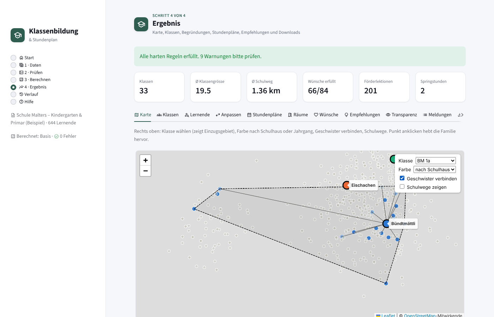

# stunden-klassen-fitter

**Klassenbildung und Stundenplan für die Volksschule** (Kindergarten und Primarschule) mit
mehreren Schulhäusern. Für Schulleitungen und Lehrpersonen gibt es eine
**Bedienoberfläche im Browser**, für Fachleute zusätzlich eine Kommandozeile. Im
Hintergrund rechnet ein exakter Optimierer (Google OR-Tools CP-SAT). Ein **Kantonsprofil**
(aktuell Luzern) liefert die rechtlichen Vorgaben samt Quellen. Alle Daten bleiben auf
dem eigenen Computer.



## Installation und Start – ohne Vorkenntnisse

1. Auf GitHub **Code → Download ZIP** klicken und die ZIP-Datei entpacken (z.B. in *Dokumente*).
2. Im entpackten Ordner doppelklicken:
   - **Windows**: `start-windows.bat`
   - **macOS**: `start-mac.command` (beim ersten Mal: Rechtsklick → *Öffnen* → *Öffnen*)
   - **Linux**: `start-linux.sh`
3. Warten. Beim ersten Mal richtet sich alles selbst ein (2–5 Minuten, Internet nötig).
   Danach öffnet sich die Bedienoberfläche im Browser. Unter Windows liegt ab dann eine
   Verknüpfung **„Klassenbildung“** auf dem Desktop.

Python muss **nicht** installiert sein. Das Startprogramm lädt das Hilfsprogramm
[uv](https://docs.astral.sh/uv/), und uv holt Python und alle Bausteine in genau
geprüften Versionen (`uv.lock`). Ist bereits Python vorhanden und uv nicht erreichbar,
wird jenes verwendet. Zum Beenden das schwarze Fenster schliessen. Die Oberfläche ist
nur auf dem eigenen Computer erreichbar (<http://localhost:8501>).

Für Fachleute: `uv run skf app` oder `pip install -e .` und dann `skf app`.

## Bedienung

| Seite | Inhalt | Bild |
|---|---|---|
| **Start** | Überblick, Fortschritt, Beispiel oder Vorlage mit einem Klick | [Start](docs/screenshots/0-start.png) |
| **1 · Daten** | Lernende, Lehrpersonen, Schulhäuser, Räume, Klassentypen, Förderangebote direkt in Tabellen bearbeiten oder Excel hochladen; **Raum- und Lehrpersonenlisten** (CSV/Excel, Spalten frei benannt) übernehmen; Gewichtung mit Schiebereglern; als Excel speichern | [Daten](docs/screenshots/1-daten.png), [Gewichtung](docs/screenshots/1b-gewichtung.png), [Raumliste](docs/screenshots/1c-raeume-import.png) |
| **2 · Prüfen** | fehlende oder widersprüchliche Angaben (Fehler, Warnung, Hinweis) | [Prüfen](docs/screenshots/2-pruefen.png) |
| **3 · Berechnen** | Szenario, Rechenzeit, Notiz; jede Berechnung wird im Verlauf gespeichert | [Berechnen](docs/screenshots/3-berechnen.png) |
| **4 · Ergebnis** | **Karte** (Klasse wählen → Einzugsgebiet mit Umriss; Farbe nach Schulhaus oder Jahrgang; **Geschwister verbinden**, getrennte Familien rot; Schulwege; Klick hebt Familie hervor) · Klassen und Klassenlisten mit Geschwistern und Vorjahresklasse · **Lernende** (Personenkarte mit Geschwistern, erfüllten und offenen Wünschen, KG-Gruppe, Verlauf) · **Anpassen** (Kind verschieben, sofort neu geprüft) · Stundenpläne · **Räume** (Auslastung, Wochenplan je Raum, Belegungsübersicht) · Wünsche und KG-Gruppen · Empfehlungen · Downloads | [Karte](docs/screenshots/4-ergebnis-karte.png), [Klassen](docs/screenshots/5-klassen.png), [Lernende](docs/screenshots/6-lernende.png), [Anpassen](docs/screenshots/7-anpassen.png), [Stundenplan](docs/screenshots/8-stundenplan.png), [Räume](docs/screenshots/8b-raeume.png), [Wünsche](docs/screenshots/9-wuensche.png), [Empfehlungen](docs/screenshots/10-empfehlungen.png), [Downloads](docs/screenshots/11-herunterladen.png) |
| **Transparenz** (in 4 · Ergebnis) | alle harten Regeln mit Prüfstatus; Abwägungen (Messwert × Gewicht = Strafpunkte je Ziel); Lösungsgüte pro Rechenschritt; bei jedem Kind **„Warum hier?“** mit allen Schulhäusern, Wegen, freien Plätzen und Gründen | [Transparenz](docs/screenshots/6b-transparenz.png), [Begründung](docs/screenshots/6-lernende.png) |
| **Verlauf** | alle gespeicherten Stände mit Kennzahlen; zwei Stände vergleichen (wer wechselte wohin); Bericht/Listen eines Standes herunterladen; Eingabedaten wiederherstellen | [Verlauf](docs/screenshots/12-verlauf.png) |

Die Screenshots erzeugt der automatische Browser-Test (`tests/test_browser_e2e.py`). Er
bedient die App mit dem Malters-Beispiel von Anfang bis Ende. Die Kartenkacheln fehlen
auf den Bildern, weil die Testumgebung keinen Zugriff auf OpenStreetMap hat.

Der **Verlauf** liegt im Benutzerordner unter `Klassenbildung/verlauf/`, anpassbar mit
der Umgebungsvariable `SKF_DATEN`. Zu jedem Stand gehören Eingabedaten, Zuteilung,
Bericht und Listen.

## Transparenz: nachvollziehen statt glauben

- **Harte Regeln**: Nach jeder Berechnung zählt ein separater Prüfer alle 15 Regeln
  nach, etwa keine Doppelbelegung, Blockzeiten, Klassengrössen, Verfügbarkeiten,
  Stundentafel und Förderlektionen. Jede Regel zeigt ✓ oder die Verstösse.
- **Abwägungen**: Jedes weiche Ziel kostet Strafpunkte = Messwert × Gewicht, zum
  Beispiel 880 km Schulwege × 100/km. Ein Balken zeigt, welche Ziele das Ergebnis
  prägen und wo ein anderes Gewicht etwas bewirkt. Die Werte werden aus dem Ergebnis
  nachgerechnet, nicht vom Solver übernommen.
- **Lösungsgüte**: Pro Rechenschritt „beweisbar optimal“ oder „mindestens x % des
  Optimums“. Grosse Schulen sind nicht immer beweisbar optimal; das wird so angezeigt
  und nicht beschönigt.
- **Begründung pro Kind**: Alle möglichen Schulhäuser mit Weg, Klassen, freien Plätzen
  und Gründen (Geschwister, Vorjahr, Wunsch, max. Schulweg), dazu ein Satz, warum
  genau diese Klasse.
- **Konfliktanalyse**: Bei Unlösbarkeit werden die Regeln genannt, die sich widersprechen.
- **Quellen**: Rechtliche Vorgaben sind mit Erlass und Link belegt; Annahmen sind als
  solche markiert.

Das Design folgt dem Design-System von
[genealogy-store](https://github.com/lucadesimoni/genealogy-store): helle Fläche,
weisse Karten, ein ruhiger Akzent (Wandtafelgrün) und Abschnittskarten zum Aufklappen.
**Eine Icon-Familie überall:** [Material Symbols Rounded](https://fonts.google.com/icons)
(Apache-2.0) – in der App über Streamlit, im Bericht als eingebettete SVGs aus derselben
Schrift (`skf/icons.py`, erzeugt mit `scripts/erzeuge_icons.py`; offline und druckbar). Der Akzent ist bewusst keine Datenfarbe; Schulhäuser und Jahrgänge haben eigene,
farbsehschwäche-geprüfte Farben.

## Was berücksichtigt wird

| Bereich | Harte Regeln (immer erfüllt) | Weiche Ziele (gewichtet, optimiert) |
|---|---|---|
| **Klassenbildung** | Jahrgang passt zum Klassentyp, Klassengrösse (optional verbindlich nach Kantonsrecht), Raumgrösse, ein Schulzimmer pro Klasse, max. Schulweg, fixes Schulhaus, Kapazität der Spezialräume, **IS**: max. Anzahl pro Klasse und Mehrfachzählung, Geschwister im selben Schulhaus (Modus `hart`) | kurze Schulwege, wenige Klassen, Grösse nahe am Ideal, Geschwister zusammen (Modus `weich`), **Kontinuität** (bisheriges Schulhaus, bisherige Klasse), **Gspänli-Regel** (niemand als Einziger aus seiner KG-Gruppe oder Klasse), **Wünsche der Erziehungsberechtigten** („zusammen mit“, „nicht zusammen mit“, Wunsch-Schulhaus), ausgeglichene Verteilung von Geschlecht, **IF, DaZ, IS**, wenige Mehrjahrgangsklassen |
| **Lehraufträge** | Qualifikation (Fach, Jahrgang, Schulhaus), max. Pensum, Verfügbarkeit, Blockzeiten an jedem Tag abdeckbar, **Förderlektionen IF/DaZ** nur an qualifizierte Lehrpersonen (SHP, DaZ) | Klassenlehrprinzip, **Lehrperson führt ihre bisherige Klasse weiter**, Mindestpensum, wenige Schulhäuser pro Lehrperson |
| **Stundenplan** | Stundentafel, keine Doppelbelegung, Verfügbarkeit von Lehrpersonen, **Schulhäusern und Räumen**, Raumgrösse, Doppellektionen, max. Lektionen pro Fach/Tag, Blockzeiten, keine Lücken für Lernende, **Förderlektionen parallel** zu passenden Fächern | wenige Präsenz-Halbtage, keine Springstunden, keine Schulhauswechsel im Halbtag |

Dazu kommen Szenarien, einstellbare Gewichte, **Meldungen mit Schweregrad und Quelle**,
eine **Konfliktanalyse** bei Unlösbarkeit, **Empfehlungen** (Lehrpersonen,
Verfügbarkeit, Räume, Ausbau), standardisierter **Import/Export** und druckfertige
**Klassenlisten und Stundenpläne**.

### Wünsche der Erziehungsberechtigten und Kindergartengruppen

In der Liste der Lernenden: `zusammen_mit` und `nicht_mit` (IDs, mit `;` getrennt),
`wunsch_schulhaus`, `bemerkung`. Dazu `bisherige_klasse` mit der Klasse bzw.
**Kindergartengruppe im Vorjahr**. Der Optimierer hält solche Gruppen möglichst zusammen
und vermeidet, dass ein Kind als einziges aus seiner Gruppe in eine neue Klasse kommt.
Der Bericht zeigt, wie viele Wünsche erfüllt sind, welche nicht, und wie sich die
KG-Gruppen auf die 1. Klassen verteilen.

### Empfehlungen

- **Lehrpersonen**: Pensenbilanz pro Schulhaus und Fach (Bedarf und freie Pensen),
  knappe Fächer, nicht ausgeschöpfte Pensen.
- **Verfügbarkeit**: Stellvertretungsreserve pro Halbtag und Schulhaus. Die Auswertung
  nennt die Teilzeit-Lehrpersonen, deren zusätzliche Verfügbarkeit am meisten bringen
  würde.
- **Räume**: Auslastung von Schulzimmern, Turnhallen und TTG-Zimmern.
- **Ausbau**: Prognose der Lernenden und benötigten Schulzimmer für die nächsten vier
  Schuljahre. Die Jahrgänge rücken nach; Wachstum einstellbar mit
  `planung: {wachstum_prozent: 3}`.

### Begriffe

*Lernende*, *Erziehungsberechtigte*, *Klassenbildung*, *Mehrjahrgangsklasse*
(altersdurchmischtes Lernen, AdL), *Schulzimmer*, *Pensum*, *Lektionen*, *Halbtag*,
*Blockzeiten*, *IF* (Integrative Förderung), *DaZ* (Deutsch als Zweitsprache), *IS*
(Integrative Sonderschulung), *SHP* (Schulische Heilpädagogin/Schulischer Heilpädagoge),
Fächer nach Lehrplan 21 (*NMG*, *BG*, *TTG*, *Bewegung und Sport*), *Stellvertretung*.

## Beispiel Malters

```bash
skf rechnen beispiele/malters/schule.yaml beispiele/malters/kinder.csv -o ausgabe -s alle
```

Das Beispiel bildet Kindergarten und Primarschule Malters (LU) nach: die Schulhäuser
**Bündtmättli** und **Eischachen** (je mit Kindergärten) und den Waldkindergarten
**Im Feld**. **Lernende, Adressen, Lehrpersonen, Raumzahlen, Koordinaten und
Stundentafel sind fiktiv bzw. Annahmen.** `beispiele/malters/erzeuge_kinder.py` erzeugt
644 Lernende reproduzierbar, inklusive IF/DaZ/IS, Vorjahresklassen, KG-Gruppen und
Wünschen. Fertig gerechnete Ergebnisse aller Szenarien:
[`beispiele/malters/ergebnis/`](beispiele/malters/ergebnis/) (Einstieg: `vergleich.html`).

## Befehle

| Befehl | Zweck |
|---|---|
| `skf rechnen schule.yaml kinder.csv -o ausgabe` | alles berechnen, Berichte und Listen schreiben (Kurzform: `skf schule.yaml kinder.csv`) |
| `skf pruefen schule.yaml kinder.csv` | nur Vorprüfung: Daten, Referenzen, Kapazitäten |
| `skf export schule.yaml kinder.csv -o daten.xlsx` | Stammdaten als Excel (ein Blatt pro Tabelle) oder `.json` |
| `skf import daten.xlsx -o ordner` | Stammdaten importieren → `schule.yaml` + `kinder.csv` (mit Referenzprüfung) |
| `skf kinder export.csv -o kinder.csv` | Export einer Schulverwaltung in die Standard-Kinderliste umwandeln |
| `skf raeume schule.yaml raumliste.xlsx` | Raumliste (Hauswartung, Liegenschaften) übernehmen; ersetzt die Räume der genannten Schulhäuser (`--ergaenzen`: nur hinzufügen) |
| `skf lehrpersonen schule.yaml personal.csv` | Lehrpersonenliste übernehmen (Name, Kürzel, Fächer, Stufen, Schulhaus, Pensum, nicht verfügbar) |
| `skf vorlage -o ordner` | Vorlagen zum Erfassen eigener Daten |
| `skf profile` | verfügbare Kantonsprofile |
| `skf app` | Bedienoberfläche im Browser |
| `skf --gewichte-anzeigen` | alle Gewichte mit Standardwert |

Wichtige Optionen für `rechnen`: `-t SEKUNDEN` (Zeitlimit pro Szenario), `-s SZENARIO`
bzw. `-s alle`, `-g NAME=ZAHL` (Gewicht), `--spalte FELD=Spaltenname`,
`--mit-foerderdaten` (IF/DaZ/IS in Klassenlisten), `--geocodieren`, `--nur-klassen`.

## Ausgabe

| Datei | Inhalt |
|---|---|
| `bericht.html` | Status, Kennzahlen, filterbare Meldungen mit Quellen, Rechtsgrundlagen, OpenStreetMap-Karte (mit Ebenen pro Schulhaus; offline SVG-Karte), Wünsche und KG-Gruppen, Empfehlungen, Klassen, Auslastung der Lehrpersonen, Raumbelegungs-Heatmap, Stundenpläne mit markierten Problemstellen |
| `klassenlisten.xlsx` | Übersicht + ein druckfertiges Blatt pro Klasse (A4, Kopfzeile wiederholt) |
| `stundenplaene.xlsx` | ein Blatt pro Klasse, Lehrperson und Spezialraum + Liste aller Lektionen |
| `druck.html` | Klassenlisten und Stundenpläne, eine Seite pro Klasse/Lehrperson (Browser → Drucken/PDF) |
| `vergleich.html` | Szenarien nebeneinander |
| `einteilung.csv`, `klassen.csv`, `lehrauftraege.csv`, `stundenplan.csv`, `meldungen.csv` | Rohdaten für Weiterverarbeitung |

Förder- und Sonderschuldaten sind besonders schützenswerte Personendaten. Sie erscheinen
in Klassenlisten nur mit `--mit-foerderdaten`.

### Meldungen, Schweregrade und Konfliktanalyse

| Schweregrad | Bedeutung | Beispiele |
|---|---|---|
| ⛔ **Fehler** | Regel verletzt oder Daten unbrauchbar, Ergebnis so nicht verwendbar | unbekannte Referenz, zu wenig Plätze, keine Lösung möglich |
| ⚠ **Warnung** | zulässig, aber vermutlich nicht gewollt | Schulweg über Maximum, Klassengrösse ausserhalb des kantonalen Rahmens (nicht verbindlich), Lehrperson nicht eingesetzt |
| ℹ **Hinweis** | Verbesserungspotenzial | Springstunde, Fussweg über 30 min (Zumutbarkeit prüfen), IF unter Richtwert, Lösung noch nicht beweisbar optimal |

Bei Meldungen mit rechtlichem Bezug steht die **Quelle** dabei, verlinkt im Bericht und
mit Titel und URL in `meldungen.csv`.

Ist eine Vorgabe unlösbar, ermittelt der Solver die **Regeln, die sich widersprechen**.
Beispiel: *„Lehraufträge: nachweislich keine Lösung möglich. Diese Regeln widersprechen
sich: Blockzeiten B 1a am Mo; Blockzeiten B 2a am Mo."* Technisch hängt jede Regelgruppe
an einem Literal, und CP-SAT liefert eine Menge widersprüchlicher Annahmen, die
anschliessend verkleinert wird.

## Kantonales Recht und Richtlinien

`basis_profil: luzern` lädt [`skf/profile/luzern.yaml`](skf/profile/luzern.yaml).
Die Schul-Konfiguration kann jeden Wert überschreiben.

| Regel | Umsetzung | Quelle |
|---|---|---|
| Klassengrössen KG und Primar 16–22 | Prüfung; mit `profil: {verbindlich: true}` harte Grenze | VBV § 7 (SRL 405), DVS „Klassen & Pensen“ |
| Blockzeiten am Vormittag | Vormittage lückenlos | VBV § 3 Abs. 4 (SRL 405) |
| Integrative Förderung | ≈ 1 Vollpensum pro 140 Lernende, im Klassenverband | Förderverordnung (SRL 406), DVS-Richtlinie IF |
| DaZ Anfangs-/Aufbauunterricht | Gruppen pro Schulhaus/Stufe; 3 L (KG–2.) bzw. 4 L (ab 3.) bei 1–3 Lernenden, +0.5 L je weitere; Aufbau 2 L | DaZ-Umsetzungshilfe DVS, § 17 Förderverordnung |
| Integrative Sonderschulung | max. IS pro Klasse, Mehrfachzählung (schulintern), Warnung bei Überschreitung der Höchstgrösse | Sonderschulverordnung § 30a (SRL 409), BehiG Art. 20 |
| Schulweg | Hinweis ab 30 min Fussweg (Zumutbarkeit prüfen, ggf. Schultransport) | VBG § 36a (SRL 400a), DVS Schulweg |
| Stundentafel | Werte selbst erfassen | WOST 2017 |
| Datenschutz | Förderdaten nur auf Wunsch in Listen | KDSG § 2 (SRL 38) |

> **Ohne Gewähr.** Stand der Recherche: Oktober 2026. Massgebend sind die aktuellen
> Fassungen auf [srl.lu.ch](https://srl.lu.ch) und die Vorgaben der Dienststelle
> Volksschulbildung. Zum Mindestwert der Klassengrösse nennen ältere Fassungen 12 (KG)
> bzw. 15 (Primar) statt 16; das ist im Profil vermerkt. Die DaZ-Formel für den
> Aufbauunterricht ab 4 Lernenden und das IF-Vollpensum (28 L) sind Annahmen. Weitere
> Kantone lassen sich als zusätzliche Profil-Datei ergänzen.

## Kinderliste

```csv
id,vorname,nachname,jahrgang,geschlecht,adresse,lat,lon,familie,if,daz,is,bisheriges_schulhaus,bisherige_klasse,zusammen_mit,nicht_mit,wunsch_schulhaus,bemerkung
K0001,Lara,Beispiel,1,w,"Ahornweg 4, 6102 Malters",47.0349,8.1971,F001,ja,,,Bündtmättli,BM KGb,K0012,,,
K0002,Noah,Beispiel,KG2,m,"Ahornweg 4, 6102 Malters",47.0349,8.1971,F001,,anfang,,Bündtmättli,BM KGb,,K0007,Eischachen,Arbeitsort
```

Pflicht sind `id` und `jahrgang`, dazu Koordinaten oder eine Adresse mit `--geocodieren`
(geo.admin.ch, mit Cache). Der Import ist tolerant und versteht unter anderem:

- **CSV mit Komma oder Semikolon**, UTF-8 oder Windows-1252, sowie **Excel (.xlsx)**
- Spaltennamen wie `Schüler-Nr`, `Vorname`/`Nachname`, `Stufe`, `Strasse`/`PLZ`/`Ort`,
  `Klasse Vorjahr`, `KG-Gruppe`, `Wunsch zusammen`, `Gspänli`, `Wunsch-Schulhaus`;
  eigene Zuordnung mit `--spalte id="Schüler-Nr"`
- **Schweizer Landeskoordinaten LV95/LV03** (`E`/`N`) → WGS84
- `1. Klasse` → `1`, `2. Kindergarten` → `KG2`; `weiblich`/`männlich`; `ja`/`x`/`1`
- `daz`: `anfang` oder `aufbau` (ein blosses `ja` gilt als Aufbauunterricht)

Unbekannte Spalten bleiben erhalten und werden mit exportiert.

## Stammdaten-Austausch

- **Excel**: `skf export … -o daten.xlsx` schreibt die Blätter Info, Schulhaeuser,
  Raeume, Klassentypen, Faecher, Lehrpersonen, Foerderangebote, Stundentafel, Kinder
  und Einstellungen. Bearbeiten und mit `skf import daten.xlsx -o ordner` zurücklesen.
- **JSON**: Format `skf-stammdaten`, Version 1, mit JSON-Schema
  [`schema/skf-stammdaten.schema.json`](schema/skf-stammdaten.schema.json).
- Export und Import sind verlustfrei (in den Tests geprüft). Beim Import und vor jeder
  Berechnung läuft eine **Referenzprüfung**: eindeutige IDs und Namen, Verweise auf
  Schulhäuser, Räume, Fächer, Jahrgänge, Kinder (`nicht_mit`) und Quellen.

## Räume planen und importieren

**Geplant wird:** Jede Klasse erhält ein Schulzimmer im passenden Raumtyp (Plätze ≥
Klassengrösse, IS zählt doppelt). Fächer mit eigenem Raumtyp (Bewegung und Sport →
Turnhalle, TTG → TTG-Zimmer, auf Wunsch Förderunterricht → Gruppenraum) werden **pro Lektion**
einem freien Raum zugeteilt – nie doppelt belegt, nur in offenen Zeiten (Sperrzeiten
des Raums, z.B. Vereinsnutzung `Fr-NM`, und des Schulhauses), auch in einem anderen
Schulhaus (`nutzt: {Turnhalle: Bündtmättli}`). Reichen die Räume nicht, nennt die
Konfliktanalyse den Engpass; die Empfehlungen zeigen Raumreserven und Ausbaubedarf.

**Ansehen:** In der App unter *Ergebnis → Räume*: Auslastung jedes Raums, ungenutzte und
fast volle Räume, Wochenplan je Raum und die Belegungsübersicht aller Räume; im Bericht
unter *Raumbelegung*; in `stundenplaene.xlsx` ein Blatt je Spezialraum.

**Importieren:** Raumlisten aus der Liegenschaftsverwaltung oder vom Hauswart können
direkt übernommen werden – in der App unter *Daten → Räume → Raumliste aus Excel/CSV
übernehmen* oder mit `skf raeume schule.yaml raumliste.xlsx`. Spaltennamen werden
erkannt (*Schulhaus/Standort/Gebäude, Raum/Zimmer/Raumnummer, Typ/Raumart/Nutzung,
Plätze/Kapazität, Anzahl, gesperrt/Sperrzeiten*), Raumarten zugeordnet (*Schulzimmer* →
Klassenzimmer, *Sporthalle* → Turnhalle, *Werkraum* → TTG-Zimmer, *Kiga* → Kindergarten)
und Zeiten übersetzt (*Freitag Nachmittag* → `Fr-NM`). Beispiel:
[`beispiele/vorlage/raumliste.csv`](beispiele/vorlage/raumliste.csv). Dasselbe gibt es für
Lehrpersonenlisten (`skf lehrpersonen …`, Pensum als `12-16`).

## Schul-Konfiguration (YAML)

Vollständige Beispiele: [`beispiele/vorlage/schule.yaml`](beispiele/vorlage/schule.yaml) (klein) und
[`beispiele/malters/schule.yaml`](beispiele/malters/schule.yaml).

```yaml
basis_profil: luzern
profil: {verbindlich: true}               # Klassengrössen nach VBV § 7 erzwingen

schulhaeuser:
  - name: Bündtmättli
    lat: 47.0338
    lon: 8.1862
    nicht_verfuegbar: [Mi-NM]              # Schulhaus geschlossen
    nutzt: {Wald: Im Feld}                 # Raumtyp eines anderen Schulhauses mitbenutzen
    raeume:
      - {name: BM-Zi, typ: Klassenzimmer, anzahl: 13, plaetze: 25}
      - {name: BM-Halle, typ: Turnhalle, anzahl: 2, plaetze: 30, nicht_verfuegbar: [Fr-NM]}

klassenbildung:
  geschwister: weich                       # weich | hart | aus
  max_schulweg_m: {KG1: 4000, default: 6000}
  vorlagen:
    - {jahrgaenge: ["1"], min: 16, max: 22, ideal: 20}
    - {jahrgaenge: ["1", "2"], min: 16, max: 22, strafe: 150}   # Mischklasse

sonderpaedagogik:
  is_zaehlt_als: 2                         # IS-Kind zählt doppelt (schulinterne Festlegung)
  max_is_pro_klasse: 2
  foerderangebote:                         # überschreibt/ergänzt das Kantonsprofil (pro Name)
    - {name: IF, merkmal: alle, pro_kind: 0.2, parallel_zu: [Deutsch, Mathematik]}

lehrpersonen:
  - {name: A. Muster, faecher: [Deutsch, Mathematik], jahrgaenge: ["1", "2"], schulhaeuser: Bündtmättli,
     pensum: [20, 28], nicht_verfuegbar: [Mi, Fr-NM, Mo-VM-1], bisherige_klasse: BM 1a}
  - {name: SHP, faecher: [IF]}             # Förderangebote: Fach = Name des Angebots
```

**Verfügbarkeiten** (`nicht_verfuegbar`) gibt es für Lehrpersonen, Schulhäuser und Räume:
`Mi` = ganzer Tag, `Fr-NM` = Halbtag, `Mo-VM-1` = einzelne Lektion.

**Förderangebote**: Lektionen = `basis` + `pro_kind` × (Anzahl − `frei_bis`), aufgerundet,
höchstens `max`. `merkmal` ist `alle`, `if`, `is`, `daz`, `daz=anfang` oder `daz=aufbau`.
Mit `gruppierung: schulhaus` (und `stufen`, `max_gruppe`) entstehen Gruppen über Klassen
hinweg. Die Lektionen liegen dann gleichzeitig zu einem `parallel_zu`-Fach aller
beteiligten Klassen.

**Kontinuität**: `bisheriges_schulhaus` und `bisherige_klasse` bei den Kindern,
`bisherige_klasse` bei Lehrpersonen. Die Lehrperson bekommt dann bevorzugt die Klasse,
in der die meisten ihrer bisherigen Kinder sind.

### Gewichte und Szenarien

```bash
python -m skf rechnen schule.yaml kinder.csv -g schulweg_pro_km=400 -g lehrperson_kontinuitaet=600
```

```yaml
szenarien:                                 # nur Änderungen gegenüber der Basis
  Kurze Schulwege:
    gewichte: {schulweg_pro_km: 400}
  Umbau Eischachen:
    schulhaeuser:
      - name: Eischachen
        raeume:
          - {name: EI-Zi, anzahl: 8}
  Lehrpersonenmangel:
    lehrpersonen:
      - {name: BM Lehrperson 12, entfernen: true}
```

## Wie es rechnet

1. **Vorprüfung**: Referenzen, Plausibilität, Kapazitäten, Qualifikationen.
2. **Klasseneinteilung A**: Schulhaus pro Kind, Klassentyp pro Raum, Anzahl Kinder und
   IS-Kinder je Jahrgang und Klasse. Gezählt wird statt einzeln zugeteilt, deshalb bleibt
   das Modell klein und frei von Symmetrien.
3. **Klasseneinteilung B**: pro Schulhaus konkrete Kinder auf Parallelklassen.
4. **Lehraufträge**: Klasse × Fach → Lehrperson, inklusive Förderlektionen und einer
   Fluss-Bedingung für die Blockzeiten.
5. **Stundenplan**: Zeitfenster und Spezialräume. Unabhängige Schulhäuser werden getrennt
   gelöst; das ist schneller und bleibt exakt.
6. **Prüfung**: Die harten Regeln werden unabhängig nachgezählt, dazu kommen
   Qualitätshinweise und die Rechtsprüfung.

Jeder Schritt meldet, ob die Lösung **beweisbar optimal** ist oder wie weit sie höchstens
vom Optimum entfernt ist. Mehr Rechenzeit (`-t`) verkleinert diese Lücke. Schulwege
werden als Luftlinie × `umweg_faktor` (Standard 1.3) geschätzt.

## Tests

```bash
pip install -e ".[test]"
pytest                                   # 51 Tests: Modell, Recht, Import/Export, Verlauf, App, Browser
pytest tests/test_browser_e2e.py -s      # nur Browser-Test (erzeugt docs/screenshots/)
```

Der Browser-Test braucht Chromium für Playwright (`playwright install chromium`).

## Datenschutz

Alle Daten bleiben lokal. Die Bedienoberfläche ist nur unter `localhost` erreichbar. Für
die Karte werden nur Kartenkacheln von OpenStreetMap geladen; Daten von Lernenden
werden nicht übertragen. Förderdaten (IF/DaZ/IS) sind besonders schützenswert (KDSG § 2)
und erscheinen in Klassenlisten nur auf ausdrücklichen Wunsch.

Kartendarstellung: [Leaflet](https://leafletjs.com) (BSD-2-Clause, im Paket enthalten),
Kartendaten © [OpenStreetMap](https://www.openstreetmap.org/copyright)-Mitwirkende.

## Lizenz und Rechte

**Proprietäre Software.** © 2026 Luca De Simoni, alle Rechte vorbehalten – siehe
[LICENSE](LICENSE). Nutzung, Weitergabe und Betrieb nur mit schriftlicher Lizenz; eine
Vertragsvorlage für Schulgemeinden liegt unter
[`docs/lizenzvertrag-vorlage.md`](docs/lizenzvertrag-vorlage.md) (vor Verwendung
juristisch prüfen lassen). Frühere Stände dieses Repositorys standen unter der GPL-3.0;
sie bleiben unter jener Lizenz, alle neuen Stände nicht.

- **Eigener Code:** jede Quelldatei trägt `SPDX-License-Identifier: LicenseRef-Proprietary`
  und den Copyright-Vermerk.
- **Drittkomponenten:** ausschliesslich freizügige Lizenzen (Apache-2.0, MIT, BSD, PSF,
  MPL-2.0 für certifi), kein Copyleft – vollständige Liste, Pflichten und Dienste
  (OpenStreetMap, geo.admin.ch) in [THIRD_PARTY_NOTICES.md](THIRD_PARTY_NOTICES.md).
  `scripts/lizenzen.py` sammelt alle Lizenztexte für ein Komplettpaket.
- **Kartenkacheln:** Die Kacheln von openstreetmap.org sind nicht für kommerzielle Last
  gedacht. Für den Verkauf einen Anbieter eintragen: `SKF_KARTE_KACHELN` (URL mit
  `{z}/{x}/{y}`) und `SKF_KARTE_QUELLE` (Namensnennung).
- **Beispieldaten** (Malters) sind erfunden; keine Verbindung zur Gemeinde Malters
  oder zum Kanton Luzern. Gesetzestexte werden nur zusammengefasst und verlinkt.
